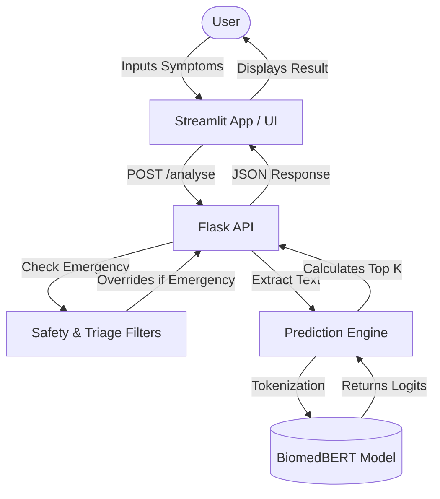
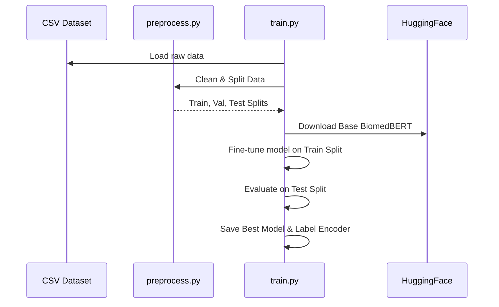
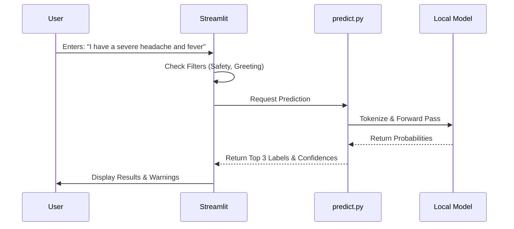

# Software Requirements Specification (SRS) for VitaCheck

## 1. Introduction

### 1.1 Purpose
The purpose of this document is to outline the software requirements for VitaCheck, an AI-powered Symptom Intelligence Chatbot. It describes the system's architecture, features, interfaces, and constraints.

### 1.2 Scope
VitaCheck takes natural language symptom descriptions from users and utilizes a fine-tuned Natural Language Processing (NLP) model (BiomedBERT) to predict potential diseases. It serves as an initial triage and educational tool. The system consists of a model training pipeline, a prediction inference engine, a Flask-based backend API, and a Streamlit-based web frontend.

---

## 2. Overall Description

### 2.1 Product Perspective
VitaCheck operates as a standalone web application. It integrates open-source Hugging Face Transformers with custom heuristic rules for safety and triage.

### 2.2 System Architecture Diagram

### 2.3 Product Features
1. **Symptom-to-Disease Classification**: Uses NLP to classify user text into one of several trained disease categories.
2. **Confidence-based Tiering**: Responds differently based on high, moderate, or low confidence thresholds.
3. **Emergency Triage**: Detects critical keywords (e.g., "heart attack", "can't breathe") and immediately recommends hospital visits.
4. **Out-of-Scope Filtering**: Identifies and rejects queries that are not related to symptoms or healthcare.

---

## 3. Specific Requirements

### 3.1 Functional Requirements
- **FR1:** The system shall accept textual symptom descriptions up to 512 tokens.
- **FR2:** The system shall return a top-1 predicted condition and a top-3 possible conditions list.
- **FR3:** The system shall calculate a confidence percentage for each prediction.
- **FR4:** The system shall include an emergency filter that bypasses the ML model if life-threatening keywords are detected.
- **FR5:** The system shall allow users to interact via a Streamlit web interface.

### 3.2 Non-Functional Requirements
- **Performance**: The prediction API should respond within 2 seconds.
- **Scalability**: The Flask API should be stateless, allowing it to be horizontally scaled behind a load balancer.
- **Accuracy**: The model should maintain an F1-score of at least 85% on the test split.

---

## 4. System Workflows

### 4.1 Training Pipeline Flow

### 4.2 Inference Flow

---

## 5. Conclusion
VitaCheck demonstrates a robust integration of modern NLP techniques with practical healthcare heuristics to provide users with quick, safe, and educational feedback regarding their symptoms.
